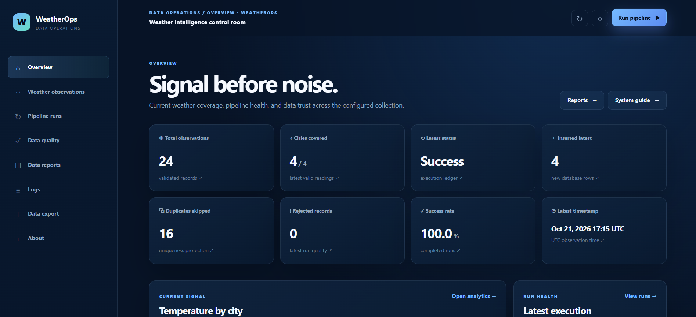
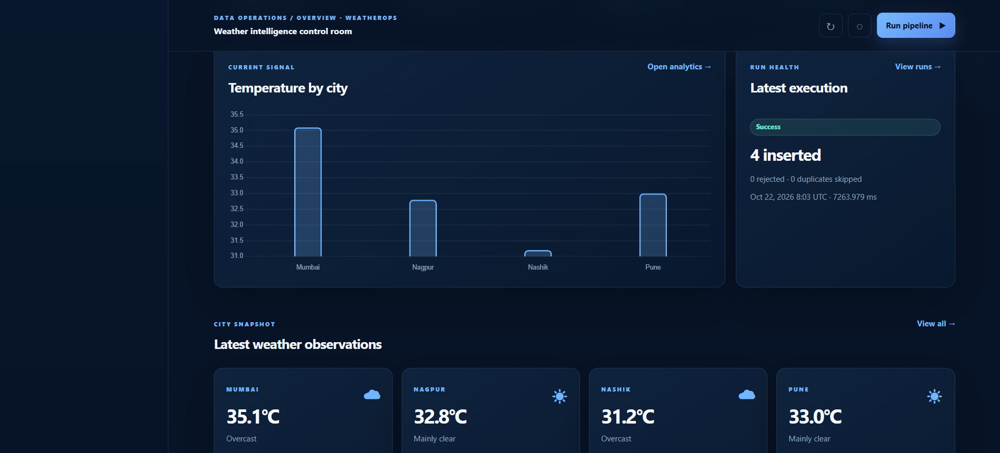
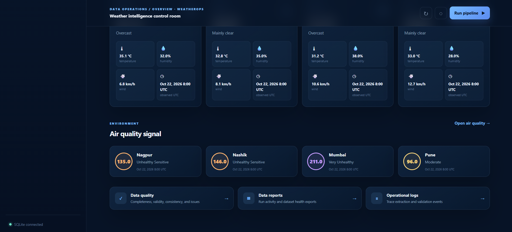
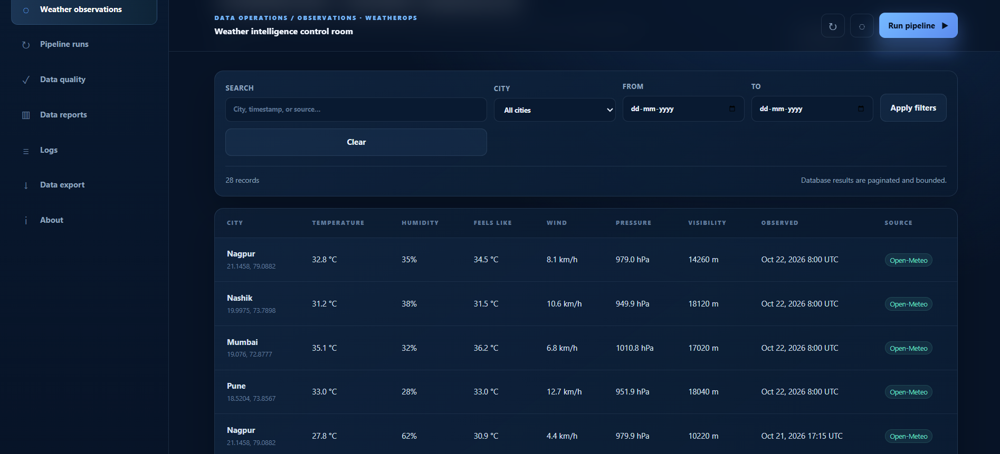
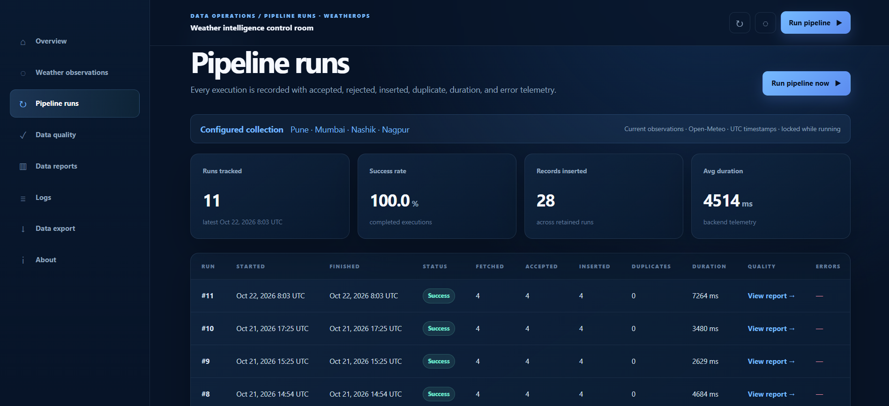
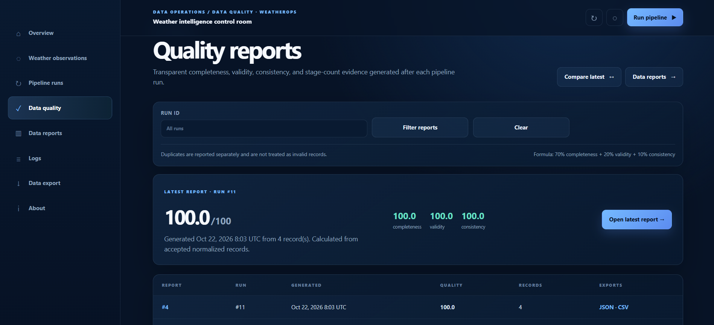
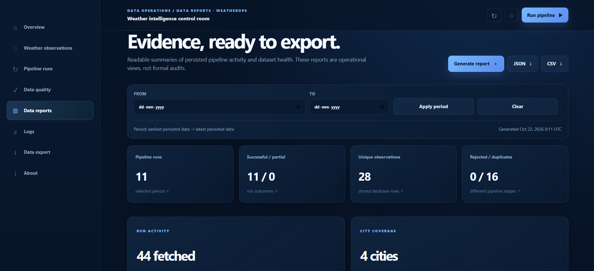
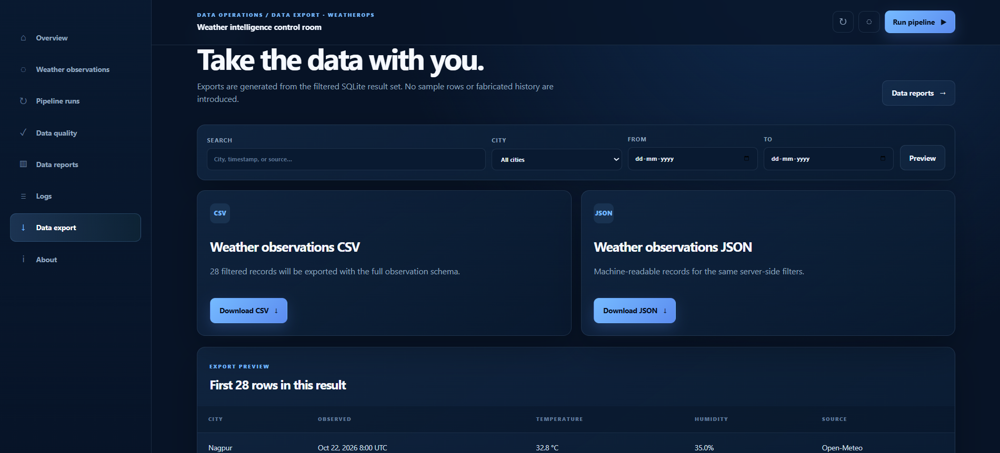
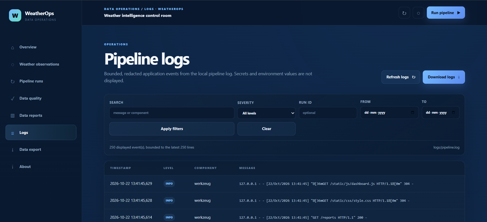
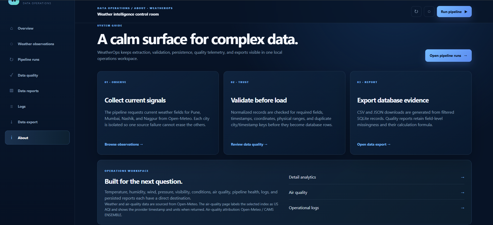

# WeatherOps 🌦️

WeatherOps is a weather data pipeline I built using Python. It fetches weather data for Pune, Mumbai, Nashik, and Nagpur from the Open-Meteo API, validates the data, and stores it in SQLite.

I also built a Flask dashboard to make the collected data easier to explore. It includes weather charts, pipeline run history, data quality reports, logs, and CSV/JSON exports.

The main goal of this project was to learn how a data pipeline works in practice, from fetching data from an API to storing, checking, and displaying it.

## What it can do

- Fetch current weather data from the Open-Meteo API.
- Validate and clean API responses before saving them.
- Store observations in an SQLite database.
- Prevent duplicate records for the same city and observation timestamp.
- Handle API errors, timeouts, and failed requests.
- Keep track of pipeline runs and the number of records processed.
- Export stored data to CSV and JSON.
- Display weather observations and charts through a Flask dashboard.
- Generate data quality reports showing missing values, validation issues, duplicates, and errors.
- View application logs when something goes wrong.
- Collect additional air quality data when the optional source is enabled.

## Tech stack

- **Python** — pipeline logic and data processing
- **Requests** — API calls
- **SQLite** — storing weather observations and pipeline history
- **Flask and Jinja2** — web application
- **HTML, CSS and JavaScript** — dashboard UI
- **Chart.js** — charts and visualizations
- **Pandas** — CSV exports
- **unittest / pytest** — testing

## How the pipeline works

The pipeline follows an ETL workflow:

1. **Extract:** Fetch weather data from Open-Meteo.
2. **Transform:** Convert the API response into a consistent format.
3. **Validate:** Check required fields, data types, timestamps, and reasonable values.
4. **Load:** Save valid observations to SQLite while handling duplicates.
5. **Export:** Generate CSV files from the stored data.
6. **Monitor:** Record pipeline results and display them on the dashboard.

Each stage is separated into Python modules to keep the code easier to understand and maintain.

For more details, see [`docs/architecture.md`](docs/architecture.md).

## Project structure

```text
WeatherOps/
├── app.py
├── requirements.txt
├── src/
│   ├── extraction.py
│   ├── transformation.py
│   ├── validation.py
│   ├── database.py
│   ├── export.py
│   ├── pipeline.py
│   ├── quality.py
│   ├── reports.py
│   └── air_quality.py
├── templates/
├── static/
│   ├── css/
│   └── js/
├── tests/
├── docs/
│   └── architecture.md
├── data/
└── logs/
```

The `data/` and `logs/` folders are used for generated files and are excluded from Git.

## Getting started

You'll need Python installed on your system.

### 1. Clone the repository

```bash
git clone <your-repository-url>
cd WeatherOps
```

Replace `<your-repository-url>` with your actual GitHub repository URL.

### 2. Create a virtual environment

On Windows PowerShell:

```powershell
py -3 -m venv .venv
.\.venv\Scripts\Activate.ps1
```

### 3. Install dependencies

```powershell
python -m pip install -r requirements.txt
```

### 4. Start the application

```powershell
python app.py
```

Open [http://127.0.0.1:5000](http://127.0.0.1:5000) in your browser.

Click **Run pipeline** to fetch the latest weather observations. The dashboard will display the results stored in the database.

The initial run requires an internet connection to access the API.

## Running the tests

Run the test suite with:

```powershell
python -m pytest -q
```

The tests use mocked API responses where appropriate, so they can test pipeline behavior without relying on live weather data.

## Data quality

I wanted the project to do more than just fetch data and save it. The pipeline also tracks what happens to the data during processing.

The reports include information such as:

- Records fetched, accepted, rejected, and inserted.
- Duplicate records skipped.
- API and processing errors.
- Missing values and validation issues.
- Pipeline execution time and status.

These metrics help identify problems instead of assuming every successful API request produces usable data.

## Things I learned

While building WeatherOps, I worked with API integration, JSON processing, SQL, data validation, database operations, Flask, logging, and automated testing.

It also helped me understand how different parts of a data application connect, from the initial API request to the information displayed on the dashboard.

## Current limitations

- The pipeline runs when triggered manually; automatic scheduling is not implemented.
- It collects current weather observations rather than maintaining a complete historical weather archive.
- Air quality collection depends on the availability of its separate data source.
- The dashboard is designed for local use and does not currently include authentication.

## Future improvements

Some things I'd like to explore next are automatic pipeline scheduling, collecting historical weather data, supporting more cities, and improving monitoring and deployment.

## Screenshots

## Screenshots

### Overview Dashboard


### Temperature and Weather Analytics


### Air Quality


### Weather Observations


### Pipeline Runs


### Data Quality


### Data Quality Reports


### Missing Values Report


### Data Export


### Application Logs


### About WeatherOps
